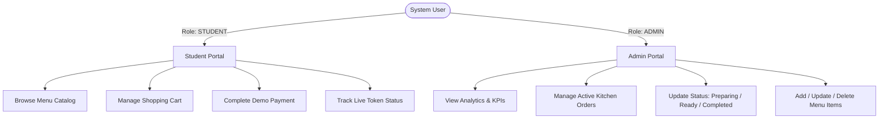
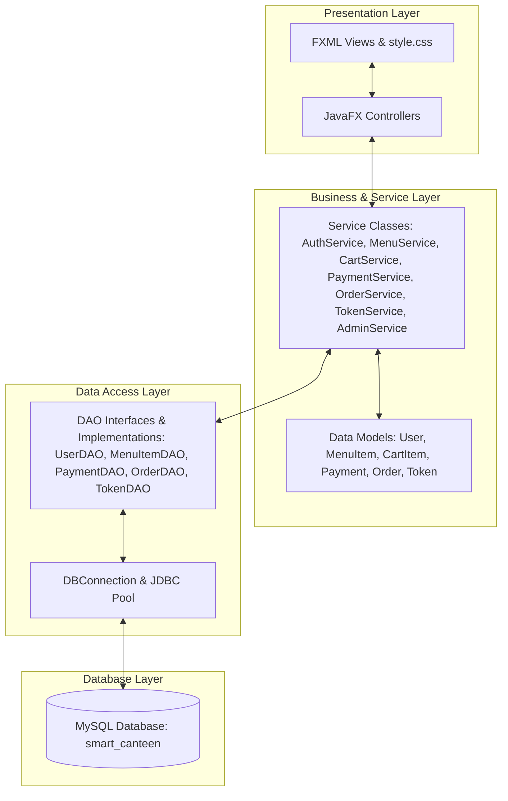
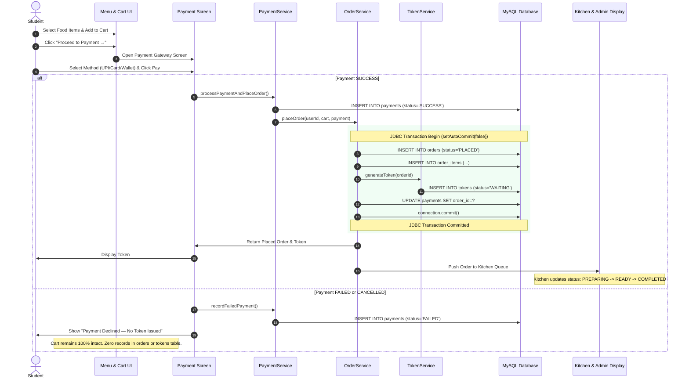
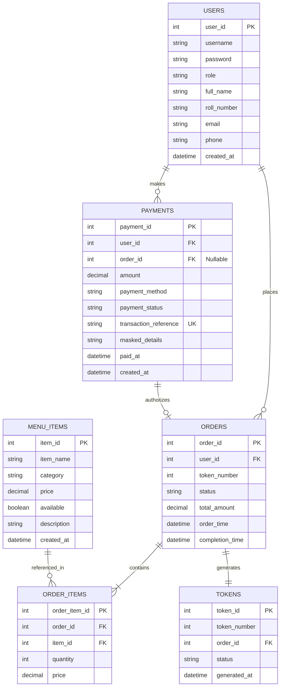
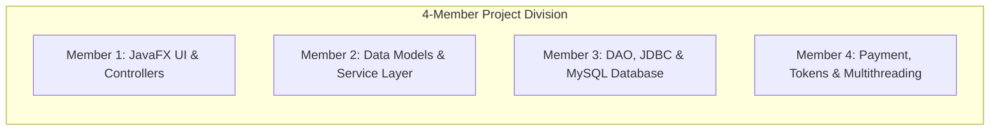

# SmartServe — Comprehensive Project Review Document

---

## 1. Project Title
**SmartServe**  
*A Modern, Payment-First Digital Food Ordering & Kitchen Token Management Application*

---

## 2. Problem Statement
In traditional college and campus canteens, ordering and food preparation suffer from severe bottlenecks:
1. **Long Physical Queues & Crowd Congestion**: Students waste valuable break time standing in physical queues to place orders and pay cash at counters.
2. **Food Wastage & Uncollected Orders**: In unpaid or pay-on-pickup token systems, students frequently place orders remotely and fail to collect them. Canteen staff prepare the food in advance, leading to substantial daily food wastage and financial losses.
3. **Manual Order Chaos & Kitchen Mismanagement**: Paper-based or verbal order slips get misplaced, leading to delayed orders, wrong servings, and customer dissatisfaction.
4. **Lack of Live Status Visibility**: Students have no visibility into how long their food will take or when it is ready, leading to crowding at the pickup counter.

---

## 3. Proposed Solution
The **SmartServe** system automates the entire canteen lifecycle through a secure, desktop-based digital platform built on JavaFX, JDBC, MySQL, and background multithreading.

Key Pillars of the Solution:
- **Payment-First Food Token Architecture**: A token is generated **strictly after successful payment authorization**. Unpaid orders never enter the kitchen queue.
- **Automated Digital Token Dispatch**: Generates unique, non-duplicate sequential tokens for easy counter collection.
- **Live Visual Kitchen Lifecycle Tracker**: Real-time status progression (`CONFIRMED` $\rightarrow$ `QUEUED` $\rightarrow$ `PREPARING` $\rightarrow$ `READY` $\rightarrow$ `COMPLETED`).
- **Background Multithreaded Processing**: Asynchronous order processing prevents JavaFX UI freezing while automating kitchen workflow simulations.
- **Centralized Admin & Menu Management**: Real-time KPI dashboard, catalog editor, and order status dispatcher for canteen operators.

---

## 4. Main Features
- **Student Authentication & Session Management**: Secure registration and login with SHA-256 hashed passwords and role-based session isolation.
- **Categorized 8-Section Food Catalog**: Over 85 North Indian and campus favorites with live search and category pill filtering.
- **Real-Time Dynamic Cart**: Add, increase, decrease, or remove items with automatic subtotal, taxes, and total recalculation.
- **Academic Demo Payment Gateway**: Multi-channel simulated payment (UPI, Card with masked reference, Campus Demo Wallet) with bank failure simulation for testing.
- **Guaranteed Unique Food Tokens**: Thread-safe atomic token generation ensuring no duplicate tokens across orders.
- **Visual Order Lifecycle Stepper**: Progress bar and stage cards showing exact preparation status.
- **Admin Dashboard & Kitchen Display**: 6 live KPI cards (Total Orders, Active, Preparing, Ready, Completed, Total Sales) with bulk and single order status updates.
- **Menu Catalog Management**: Full CRUD interface (Add, Update, Delete, Toggle Availability) for canteen managers.

---

## 5. User Roles

### 1. Student
- Registers and logs in with unique username and roll number.
- Explores categorized menu items, searches food, and adds items to cart.
- Selects demo payment method (UPI / Card / Wallet) and authorizes transaction.
- Receives unique token upon successful payment and tracks preparation in real time.

### 2. Admin (Canteen Staff / Manager)
- Monitors real-time sales and order volume across the canteen.
- Views only paid/confirmed orders in the kitchen preparation queue.
- Updates order lifecycle status from `CONFIRMED` $\rightarrow$ `PREPARING` $\rightarrow$ `READY` $\rightarrow$ `COMPLETED`.
- Manages menu items, pricing, categories, and marks items available or unavailable.

---

## 6. Architecture Overview

The system strictly adheres to the **Layered MVC-DAO Architecture**:

$$\text{JavaFX UI (FXML)} \longrightarrow \text{Controller} \longrightarrow \text{Model} \longrightarrow \text{Service} \longrightarrow \text{DAO} \longrightarrow \text{DBConnection} \longrightarrow \text{MySQL Database}$$

---

## 7. Architecture Layers Explained in Simple Language

| Layer | Plain English Analogy | Core Question It Answers | Responsibility |
|---|---|---|---|
| **MODEL** | *The Blueprint / Data Carrier* | **"What is the data?"** | Pure Java classes (POJOs) representing database entities (e.g. `User`, `MenuItem`, `Payment`, `Order`, `Token`). Contains private fields, constructors, getters, and setters. No business logic or database queries. |
| **CONTROLLER** | *The Event Listener* | **"What did the user click?"** | Bridges the FXML UI and Java logic. Handles button clicks, reads text from fields, updates labels/tables, and delegates work to Service classes. **Never contains SQL**. |
| **SERVICE** | *The Brain / Business Rules* | **"What should the application do?"** | Contains all application business logic (e.g. password validation, total calculations, payment verification, transaction coordinator, token generation rules). **Never contains JavaFX controls or raw SQL**. |
| **DAO** *(Data Access Object)* | *The Warehouse Keeper* | **"How do we store/retrieve data?"** | Contains pure SQL queries, `PreparedStatement`, and `ResultSet` mapping. Converts database rows into Java Model objects and vice-versa. |
| **DATABASE** | *The Permanent Vault* | **"Where is the data stored?"** | Relational MySQL database holding persistent tables (`users`, `menu_items`, `payments`, `orders`, `order_items`, `tokens`). Data survives application restarts. |

---

## 8. Complete Place Order Flow

---

## 9. Food Wastage Problem & The Payment-First Solution

### The Business Dilemma
In college canteens, students place orders remotely during lectures. If food is prepared before payment:
- Students who get delayed or change their minds never collect the food.
- Perishable items (freshly cooked dosas, thalis, sandwiches, beverages) spoil and must be discarded.
- Canteens suffer major daily financial waste.

### The Payment-First Enforcement
In our system:
1. **No Token Without Payment**: A token number is issued **only after** the transaction returns `PaymentStatus.SUCCESS`.
2. **No Order In Kitchen Without Token**: Kitchen display boards filter exclusively for orders where `payment_status = 'SUCCESS'`.
3. **Cart Preserved on Failure**: If payment fails or is cancelled, the student’s cart is retained so they can retry without losing their selected items, but no food is prepared.

---

## 10. Menu Categories (8 Canteen Sections)

The canteen catalog contains 86 items organized into 8 distinct categories:

| # | Category | Description | Popular Examples |
|---|---|---|---|
| 1 | **North Indian** | Classic Punjabi curries, thalis, and tawa rotis | Chole Bhature, Rajma Chawal, Paneer Butter Masala, Dal Makhani |
| 2 | **Chaat** | Fresh tangy and spicy street snacks | Pani Puri, Sev Puri, Dahi Bhalla, Pav Bhaji, Bhel Puri |
| 3 | **Healthy** | Nutritious protein-rich meals and fresh salads | Sprouts Salad, Boiled Egg Chaat, Paneer Salad, Fruit Bowl |
| 4 | **Breakfast** | Traditional hot morning breakfast staples | Masala Dosa, Idli Sambar, Poha, Upma, Medu Vada |
| 5 | **Snacks** | Quick crispy bites and rolls | Samosa, Veg Cutlet, Paneer Tikka Roll, Maggi, Cheese Toast |
| 6 | **Beverages** | Hot and cold traditional canteen drinks | Masala Chai, Filter Coffee, Chaas (Buttermilk), Sweet Lassi |
| 7 | **Healthy Drinks** | Freshly pressed juices and detox shakes | Fresh Orange Juice, Mosambi Juice, Green Smoothie, Coconut Water |
| 8 | **Combos** | Value meal bundles for students | Deluxe Thali Combo, Chole Bhature + Lassi, Burger + Beverage |

---

## 11. Database Schema & Relational Structure

### Table Descriptions & Relationships
1. **`users`**: Stores user profiles. Roles: `STUDENT` or `ADMIN`.
2. **`menu_items`**: Contains item catalog with pricing, category, and availability flags.
3. **`payments`**: Records all payment attempts (`SUCCESS`, `FAILED`, `CANCELLED`, `PENDING`) with unique transaction references and masked credentials.
4. **`orders`**: Represents confirmed student food orders with current lifecycle status (`PLACED`, `PREPARING`, `READY`, `COMPLETED`, `CANCELLED`).
5. **`order_items`**: Junction table mapping individual food items and quantities to an order.
6. **`tokens`**: Stores the single unique food token issued per paid order.

---

## 12. JDBC (Java Database Connectivity) Concepts

| JDBC Concept | Purpose in SmartServe | Code Example / Usage |
|---|---|---|
| **`Connection`** | Represents the active session between Java and MySQL. | `Connection conn = DBConnection.getConnection();` |
| **`PreparedStatement`** | Pre-compiled SQL query preventing SQL Injection. | `PreparedStatement ps = conn.prepareStatement("SELECT * FROM users WHERE username = ?");` |
| **`ResultSet`** | Tabular data stream returned by SQL `SELECT`. | `ResultSet rs = ps.executeQuery(); while (rs.next()) { ... }` |
| **`executeQuery()`** | Used **only for read queries** (`SELECT`). Returns a `ResultSet`. | `ResultSet rs = ps.executeQuery();` |
| **`executeUpdate()`** | Used for **write operations** (`INSERT`, `UPDATE`, `DELETE`). Returns affected row count (`int`). | `int affectedRows = ps.executeUpdate();` |
| **`Transactions`** | Bundles multiple SQL statements into one atomic unit (All-or-Nothing). | `conn.setAutoCommit(false);` |
| **`commit()`** | Permanently writes all changes in the transaction if all operations succeed. | `conn.commit();` |
| **`rollback()`** | Cancels and undoes all changes in the transaction if any query fails. | `conn.rollback();` (Inside `catch` block) |

---

## 13. JavaFX Concepts

| JavaFX Component | Purpose in SmartServe | Usage in Application |
|---|---|---|
| **`FXML`** | XML-based declarative markup language defining UI layout and hierarchy. | `menu.fxml`, `payment.fxml`, `admin_dashboard.fxml` |
| **`@FXML` Annotation** | Binds UI controls in the FXML file to Java fields and methods in the Controller. | `@FXML private TextField usernameField;` |
| **`Button`** | Clickable action control for submitting forms, navigation, or filtering. | `<Button onAction="#handleLogin" text="Sign In" />` |
| **`TextField` / `PasswordField`** | Single-line user input for text and masked credentials. | `searchField`, `passwordField`, `upiIdField` |
| **`ComboBox`** | Dropdown selection list for picking menu categories or filter options. | `categoryComboBox` |
| **`TableView`** | Displays relational data in structured rows and columns. | `ordersTable` on Admin Dashboard, `menuTable` on Manage Menu |
| **Events (`ActionEvent`)** | Triggers Controller methods when user clicks, types, or interacts with the UI. | `public void handleProceedToPayment(ActionEvent event)` |

---

## 14. Multithreading & Background Processing

### Why Multithreading is Essential
JavaFX applications run on a single **JavaFX Application Thread** (UI Thread). If long-running tasks (such as background order queue processing or database operations) are run on the UI thread, the entire window freezes, buttons become unresponsive, and the operating system marks the app as *"Not Responding"*.

### System Threading Components
1. **`AppThreadPool`**: A centralized, managed `ExecutorService` that controls background thread lifecycles safely.
2. **`OrderQueueManager`**: Thread-safe in-memory FIFO queue (`ConcurrentLinkedQueue`) holding active paid orders.
3. **`OrderProcessor`**: Background worker simulating kitchen order status progression (`QUEUED` $\rightarrow$ `PREPARING` $\rightarrow$ `READY` $\rightarrow$ `COMPLETED`).
4. **`Platform.runLater()`**: The thread-safety bridge that sends UI updates from background threads safely back to the JavaFX Application Thread.

---

## 15. Security & Data Validation

1. **Input Validation**: Strict regex matching on usernames, roll numbers, prices, and UPI VPAs (`username@bank`) via [`Validator.java`](file:///c:/Users/NEHA%20KUMARI/Downloads/Smart_canteen/src/main/java/com/smartcanteen/util/Validator.java).
2. **Parameterized Prepared Statements**: 100% of database queries use `?` placeholders, eliminating **SQL Injection attacks**.
3. **Password Security**: Passwords are never stored in plain text; they are hashed using **SHA-256** with hexadecimal encoding via [`PasswordHasher.java`](file:///c:/Users/NEHA%20KUMARI/Downloads/Smart_canteen/src/main/java/com/smartcanteen/util/PasswordHasher.java).
4. **Zero Sensitive Card Data Storage**: Full 16-digit card numbers and CVVs are strictly processed in-memory during simulation and **never written to the database**. Only safe masked strings (e.g. `Card: **** **** **** 3456 (Rahul Kumar)`) are stored.
5. **Session Isolation**: Centralized [`SessionManager.java`](file:///c:/Users/NEHA%20KUMARI/Downloads/Smart_canteen/src/main/java/com/smartcanteen/util/SessionManager.java) guarantees that student and admin sessions cannot overlap or hijack privileges.

---

## 16. Team Member Responsibilities

### Member 1: JavaFX UI & Controllers
- **Focus**: User Experience & Interaction.
- **Responsibilities**:
  - Designed all FXML views (`login.fxml`, `menu.fxml`, `cart.fxml`, `payment.fxml`, `order_confirmation.fxml`, `token_status.fxml`, `admin_dashboard.fxml`).
  - Implemented Controller event handlers and navigation via [`SceneNavigator.java`](file:///c:/Users/NEHA%20KUMARI/Downloads/Smart_canteen/src/main/java/com/smartcanteen/util/SceneNavigator.java).
  - Maintained central design system and CSS stylesheet ([`style.css`](file:///c:/Users/NEHA%20KUMARI/Downloads/Smart_canteen/src/main/resources/css/style.css)).

### Member 2: Model & Service Layer
- **Focus**: Business Rules & Application State.
- **Responsibilities**:
  - Created POJO models (`User`, `MenuItem`, `CartItem`, `Payment`, `Order`, `Token`).
  - Implemented core services: [`AuthService`](file:///c:/Users/NEHA%20KUMARI/Downloads/Smart_canteen/src/main/java/com/smartcanteen/service/AuthService.java), [`MenuService`](file:///c:/Users/NEHA%20KUMARI/Downloads/Smart_canteen/src/main/java/com/smartcanteen/service/MenuService.java), [`CartService`](file:///c:/Users/NEHA%20KUMARI/Downloads/Smart_canteen/src/main/java/com/smartcanteen/service/CartService.java), [`AdminService`](file:///c:/Users/NEHA%20KUMARI/Downloads/Smart_canteen/src/main/java/com/smartcanteen/service/AdminService.java).
  - Implemented input validation and SHA-256 password hashing.

### Member 3: DAO, JDBC & Database
- **Focus**: Persistence & Relational Integrity.
- **Responsibilities**:
  - Designed MySQL schema, tables, foreign keys, and indexes (`smart_canteen` database).
  - Built JDBC connection manager ([`DBConnection.java`](file:///c:/Users/NEHA%20KUMARI/Downloads/Smart_canteen/src/main/java/com/smartcanteen/util/DBConnection.java)).
  - Implemented DAO interfaces and classes: [`UserDAO`](file:///c:/Users/NEHA%20KUMARI/Downloads/Smart_canteen/src/main/java/com/smartcanteen/dao/impl/UserDAO.java), [`MenuItemDAO`](file:///c:/Users/NEHA%20KUMARI/Downloads/Smart_canteen/src/main/java/com/smartcanteen/dao/impl/MenuItemDAO.java), [`PaymentDAO`](file:///c:/Users/NEHA%20KUMARI/Downloads/Smart_canteen/src/main/java/com/smartcanteen/dao/impl/PaymentDAO.java), [`OrderDAO`](file:///c:/Users/NEHA%20KUMARI/Downloads/Smart_canteen/src/main/java/com/smartcanteen/dao/impl/OrderDAO.java), [`TokenDAO`](file:///c:/Users/NEHA%20KUMARI/Downloads/Smart_canteen/src/main/java/com/smartcanteen/dao/impl/TokenDAO.java).

### Member 4: Payment, Order, Token & Multithreading
- **Focus**: Transactions & Concurrency.
- **Responsibilities**:
  - Built the Payment-First engine in [`PaymentService.java`](file:///c:/Users/NEHA%20KUMARI/Downloads/Smart_canteen/src/main/java/com/smartcanteen/service/PaymentService.java).
  - Engineered atomic JDBC transactions (`setAutoCommit(false)`, `commit()`, `rollback()`) in [`OrderService.java`](file:///c:/Users/NEHA%20KUMARI/Downloads/Smart_canteen/src/main/java/com/smartcanteen/service/OrderService.java).
  - Implemented token generation ([`TokenGenerator.java`](file:///c:/Users/NEHA%20KUMARI/Downloads/Smart_canteen/src/main/java/com/smartcanteen/util/TokenGenerator.java)) and background threads ([`AppThreadPool.java`](file:///c:/Users/NEHA%20KUMARI/Downloads/Smart_canteen/src/main/java/com/smartcanteen/util/AppThreadPool.java)).

---

## 17. Comprehensive Viva Questions & Simple Answers (35 Questions)

### Category A: General & Project Concept
**Q1: What is the main objective of SmartServe?**  
*Answer:* To eliminate long physical queues, prevent food wastage, and automate kitchen token dispatch through a digital payment-first platform.

**Q2: What is the "Payment-First" business flow?**  
*Answer:* Food tokens are generated only after payment is successful. If payment fails or is cancelled, no token is issued, preventing the kitchen from preparing uncollected food.

**Q3: What are the two main roles in the system?**  
*Answer:* `STUDENT` (browses menu, pays, and tracks tokens) and `ADMIN` (manages catalog, tracks sales, and updates kitchen order statuses).

**Q4: Which technology stack is used in this project?**  
*Answer:* Java 21, JavaFX (FXML + CSS), JDBC, MySQL Database, and Maven.

**Q5: What happens if a student cancels payment during checkout?**  
*Answer:* The payment status is marked `CANCELLED`, no token or order is created, and the student's cart items are preserved intact.

---

### Category B: Architecture & Design Pattern
**Q6: What software architecture does this application follow?**  
*Answer:* Layered MVC-DAO Architecture (`FXML UI` $\rightarrow$ `Controller` $\rightarrow$ `Model` $\rightarrow$ `Service` $\rightarrow$ `DAO` $\rightarrow$ `DBConnection` $\rightarrow$ `Database`).

**Q7: Why do we separate the Controller and Service layers?**  
*Answer:* The Controller only handles UI events (clicks and inputs), while the Service layer contains business rules (calculations, validations, and payment verification). This keeps code modular, reusable, and easy to maintain.

**Q8: Why is SQL prohibited inside Controller classes?**  
*Answer:* Putting SQL in Controllers violates Separation of Concerns. Database queries must reside strictly inside DAO classes.

**Q9: What is the purpose of the Model layer?**  
*Answer:* Models are Plain Old Java Objects (POJOs) that represent real-world entities (like `User`, `MenuItem`, `Order`) and carry data between layers.

**Q10: What is the Singleton Pattern and where is it used?**  
*Answer:* The Singleton pattern ensures a class has only one active instance. It is used in `CartService.getInstance()` and `DBConnection.getConnection()`.

---

### Category C: JDBC & Database
**Q11: What is JDBC?**  
*Answer:* Java Database Connectivity (JDBC) is a Java API that enables Java applications to connect and execute SQL queries against relational databases like MySQL.

**Q12: What is the difference between `Statement` and `PreparedStatement`?**  
*Answer:* `Statement` runs raw SQL and is vulnerable to SQL injection. `PreparedStatement` pre-compiles the query and uses parameterized `?` placeholders, providing security and faster execution.

**Q13: What is SQL Injection and how did you prevent it?**  
*Answer:* SQL Injection occurs when an attacker inputs malicious SQL fragments to manipulate queries. We prevented it by using `PreparedStatement` for 100% of our database queries.

**Q14: What is the difference between `executeQuery()` and `executeUpdate()`?**  
*Answer:* `executeQuery()` is used for `SELECT` statements and returns a `ResultSet`. `executeUpdate()` is used for `INSERT`, `UPDATE`, or `DELETE` and returns the number of rows affected.

**Q15: What is a Database Transaction?**  
*Answer:* A transaction is a sequence of SQL operations executed as a single atomic unit. Either all operations succeed (`commit`), or none take effect (`rollback`).

**Q16: Why is transaction management critical when placing an order?**  
*Answer:* Placing an order requires inserting into `orders`, `order_items`, and `tokens` simultaneously. If any query fails, `rollback()` ensures no half-created orders remain in the database.

**Q17: How do you start and commit a transaction in JDBC?**  
*Answer:* Start with `connection.setAutoCommit(false);`, execute queries, and commit with `connection.commit();`. If an exception occurs, call `connection.rollback();` inside the `catch` block.

**Q18: What is a Foreign Key? Give an example from your project.**  
*Answer:* A Foreign Key links a column in one table to the Primary Key in another table. In our project, `orders.user_id` is a foreign key referencing `users.user_id`.

**Q19: How are payments related to orders in your database?**  
*Answer:* `payments.order_id` links a payment record directly to the generated order, creating a verifiable audit trail for every transaction.

---

### Category D: JavaFX & UI
**Q20: What is FXML?**  
*Answer:* FXML is an XML-based file format used in JavaFX to define user interface components and layouts separately from Java code.

**Q21: What is the `@FXML` annotation?**  
*Answer:* `@FXML` marks controller fields and methods so the JavaFX runtime can link them to elements defined in the FXML markup.

**Q22: What is `TableView` and how is it populated in JavaFX?**  
*Answer:* `TableView` displays tabular data. Columns are bound to model properties using `PropertyValueFactory` or lambda expressions, and data is supplied via an `ObservableList`.

**Q23: How do you switch scenes in JavaFX?**  
*Answer:* By loading the new FXML file using `FXMLLoader.load()`, setting it into a `Scene`, and applying it to the current `Stage` via our `SceneNavigator` utility.

**Q24: How is the application styled?**  
*Answer:* Using CSS (`style.css`), which defines unified styles for cards, typography, buttons, tables, and status badges.

---

### Category E: Multithreading & Concurrency
**Q25: Why is multithreading used in this project?**  
*Answer:* To run background kitchen order progression and token updates asynchronously without freezing the JavaFX UI thread.

**Q26: What is the JavaFX Application Thread?**  
*Answer:* It is the primary UI thread responsible for rendering graphics and processing user interactions in JavaFX.

**Q27: What happens if a background thread modifies a JavaFX UI component directly?**  
*Answer:* JavaFX throws an `IllegalStateException: Not on FX application thread`.

**Q28: How do you safely update JavaFX UI controls from a background thread?**  
*Answer:* By wrapping the UI update code inside `Platform.runLater(() -> { /* update UI */ });`.

**Q29: What is `TokenGenerator` and how does it prevent duplicate tokens?**  
*Answer:* It uses a thread-safe `AtomicInteger` that increments sequentially in memory, ensuring every paid order receives a unique token number.

---

### Category F: Security & Validation
**Q30: How are user passwords stored securely?**  
*Answer:* Passwords are hashed using the cryptographic SHA-256 algorithm before storing in the database. Plaintext passwords are never saved.

**Q31: How is sensitive payment card information handled?**  
*Answer:* CVVs and full card numbers are never stored in the database. Only masked strings (e.g. `**** **** **** 3456`) are saved for transaction records.

**Q32: How does the system validate UPI IDs?**  
*Answer:* Using regular expression pattern matching (`^[a-zA-Z0-9.\\-_]{2,64}@[a-zA-Z0-9]{2,32}$`), checking for a valid format like `student@upi`.

**Q33: What is the purpose of `SessionManager`?**  
*Answer:* It holds the currently authenticated `User` object in memory, providing role verification (`isStudent()`, `isAdmin()`) and secure logout cleanup.

---

### Category G: Project Delivery & Testing
**Q34: How did you test payment failure handling?**  
*Answer:* We included a simulated failure switch in `PaymentService` that marks the payment as `FAILED`, verifies that no token is issued, and confirms the cart remains intact.

**Q35: What happens if MySQL is restarted while the app is closed?**  
*Answer:* All registered users, catalog items, payments, and order history persist safely in the MySQL database and reload upon relaunch.
